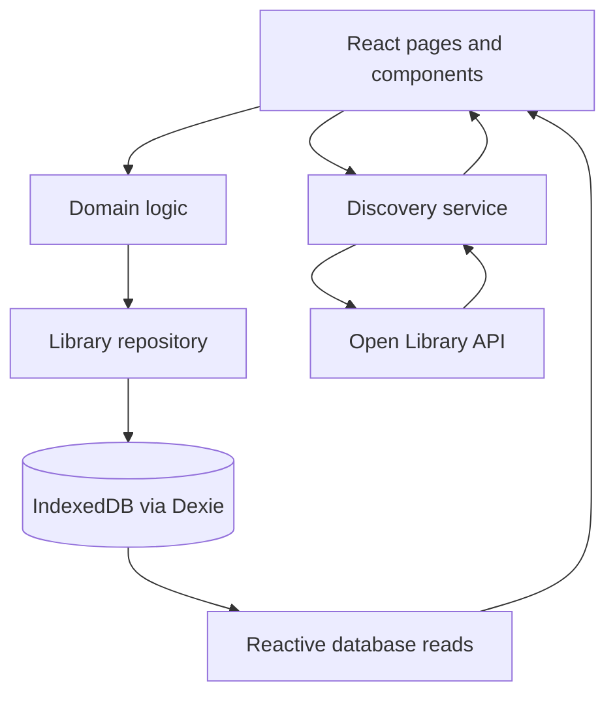

# PageTrail — MVP Technical Architecture

## 1. Scope and architectural decision

This document translates [the MVP product plan](./plan.md) into a technical architecture using the selected stack. The product plan remains the source of truth for feature scope.

PageTrail is a single-user, browser-based application. React renders the interface, IndexedDB stores the user's library, and Open Library supplies discovery data. There is no application backend, registration, or login in the MVP.

Build and verify the application locally first. Deployment is a later step, outside the initial MVP build.

## 2. Selected stack

| Responsibility | Technology | Purpose |
|---|---|---|
| User interface | React | Reusable components for books, forms, and statistics |
| Language | TypeScript | Explicit types for books, API results, and reading states |
| Development and build | Vite | Local development server and production asset build |
| Navigation | React Router | Four application pages and direct book-detail URLs |
| Persistent storage | IndexedDB through Dexie | Structured local records, transactions, and schema versions |
| Reactive database reads | dexie-react-hooks | Keep library views and statistics current after saved changes |
| Styling | CSS Modules and shared CSS variables | Scoped component styles and consistent design tokens |
| Discovery | Open Library Search API and cover URLs | Search by title or author and display available metadata |
| Unit testing | Vitest | Verify business rules and metadata normalization |
| Browser testing | Playwright | Verify complete user workflows and persistence |

Use React state for temporary interface state. No additional global state library is needed for the MVP.

## 3. Application structure and data flow

The application has four layers:

1. **Pages and components:** Render data, collect input, and display loading, empty, and error states.
2. **Domain logic:** Validate updates, calculate progress and statistics, and apply reading-status rules.
3. **Library repository:** Own Dexie queries and writes, including duplicate prevention and atomic updates.
4. **Discovery service:** Call Open Library and normalize external responses into application types.

The layers communicate as follows:

Discovery results remain temporary until the user adds a book. Adding a book stores a snapshot of its metadata together with personal reading data. Library and detail pages read that snapshot; they do not need a discovery request to display saved information.

Successful database writes drive updated cards and dashboard statistics. Show a save error if a write fails, and keep the user's unsaved form input available for retry. Do not report success before persistence completes.

## 4. Pages and routes

| Route | Page | Responsibility |
|---|---|---|
| `/` | Dashboard | Total books, finished books, currently reading, and average rating |
| `/library` | My Library | Saved cards, local search, status filtering, title/rating sorting, and removal |
| `/discover` | Discover Books | Online title/author search, result previews, and Add to Library |
| `/books/:bookId` | Book Details | Saved metadata, reading status, page count, progress, rating, and note |

Use a shared application shell for navigation and page layout. A discovery preview is an inline panel or dialog rather than an additional main page. Book Details is reserved for saved books.

Unknown routes show a friendly not-found view. A detail route for a removed or unknown book offers a return to the library.

## 5. Persistent data model

Use one `books` table for the MVP. Each record contains both the saved metadata and the user's reading information; separate rating, note, and progress tables are unnecessary.

| Field | Type | Meaning |
|---|---|---|
| `id` | string | Locally generated stable identifier used in routes |
| `source` | `openLibrary` | Metadata provider |
| `sourceWorkId` | string | Canonical Open Library work ID used for duplicate detection |
| `title` | string | Saved book title |
| `authors` | string array | Saved author names; may be empty |
| `coverUrl` | string or null | External cover URL; missing or failed images use a local fallback |
| `totalPages` | positive integer or null | Initial metadata value or user-corrected page count |
| `currentPage` | nonnegative integer | Last saved reading position; initially zero |
| `status` | `wantToRead`, `currentlyReading`, or `finished` | Reading state; initially `wantToRead` |
| `rating` | integer 1–5 or null | Optional personal rating |
| `note` | string | One editable plain-text note; initially empty |
| `createdAt` | timestamp number | Time the book was added |
| `updatedAt` | timestamp number | Time of the latest saved change |

The initial Dexie schema uses `id` as the primary key, a unique compound index on `source` and `sourceWorkId`, and a status index. Search and sorting can run in memory over the modest personal library expected in the MVP. Do not store derived progress percentages or dashboard totals.

**Book identity decision:** Different editions of the same Open Library work count as one saved book. Normalize the API work key before storing it. The unique database index enforces this rule even if two add operations happen concurrently. A duplicate insertion becomes an “Already in Library” result.

This identity choice does not guarantee identical page counts across editions. Page metadata is an initial suggestion, and the user's correction is authoritative. Ignore discovery records without a usable work ID rather than inventing an unreliable identity from title and author.

## 6. Domain rules

### Reading status and progress

- Adding a book sets `wantToRead`, page zero, no rating, and an empty note.
- Progress entry is available for books marked `currentlyReading`.
- Page values must be integers. Current page cannot be negative or exceed a known total; total pages must be positive when supplied.
- If total pages are unknown, ask the user to enter them before recording page-based progress. Show an unknown progress state rather than dividing by zero or presenting a misleading percentage.
- Calculate percentage from `currentPage / totalPages`, rounding only for display.
- Saving progress at the total page count automatically sets `finished` in the same database write.
- Validate a page-count correction together with the current page. If the new total is below the saved current page, ask the user to correct the position before saving. Do not silently discard progress.
- A valid page-count correction that brings a currently reading book to 100% also sets `finished`.
- Manual status changes remain available. They preserve page values, ratings, and notes; manually marking a book finished does not require a known page count.
- Status is authoritative for dashboard counts. A manual status change does not immediately trigger automatic completion; completion is applied when progress or page count is saved.

These transition details resolve implementation edge cases while preserving the plan's manual status control.

### Ratings, notes, and removal

- Accept an integer rating from 1 to 5, or null to remove it, regardless of reading status.
- Save one plain-text note per book. Clearing it removes the note's content.
- Render notes as text, never as executable HTML.
- Confirm removal before deleting the entire saved record, including its progress, rating, and note.

### Library and dashboard

- Library search matches saved titles and author names without case sensitivity.
- Support all-books or one-status filtering.
- Sort titles alphabetically or ratings highest first; unrated books come last. Use title and then ID as stable tie-breakers.
- Derive total, finished, and currently-reading counts from saved records.
- Average only non-null ratings. Display one decimal place and a friendly “No ratings yet” value when none exist.

## 7. Open Library integration

The discovery service uses the browser's Fetch API to call Open Library's Search API. Offer title and author search modes so the request expresses the user's intended field. Request only the metadata needed for result cards and saved records, and limit result counts rather than downloading an unrestricted response.

Use explicit search submission for the MVP. Cancel superseded requests or ignore stale responses so an older result cannot overwrite a newer search.

Normalize external responses before passing them to components:

- Extract a canonical work ID, title, author names, available cover reference, and a usable page-count estimate.
- Treat missing authors, covers, and page counts as expected cases.
- Display a local default cover when a cover is unavailable or fails to load.
- Handle HTTP failures, network failures, malformed responses, and empty results separately from successful results.
- Compare results with saved work IDs to display “Already in Library.”

Use a finite request timeout and offer retry after a failed search. Discovery failures must not block navigation, local reads, or local edits. Verify browser access and current API usage requirements during implementation; any browser-access limitation must be resolved explicitly rather than silently introducing a backend.

Saved ratings and notes never appear in discovery requests. Cover images remain external resources, so covers may be unavailable without a network connection even when saved metadata is accessible.

## 8. State and persistence boundaries

| State | Owner |
|---|---|
| Saved books and personal reading data | IndexedDB |
| Visible saved records and dashboard statistics | Reactive Dexie reads and derived calculations |
| Discovery query, results, loading, and errors | Page/component state |
| Form drafts, validation messages, and confirmation dialogs | Component state |
| Active page and selected saved book | React Router |
| Library search, filter, and sort controls | Library page state |

IndexedDB is the source of truth for saved data. Avoid maintaining a second independent global copy of the library. Use versioned Dexie schemas for future data-model changes, preserving existing records through migrations.

Persistence is scoped to the same browser profile and origin, including the port. Keep the local development origin stable. Data survives ordinary closing and reopening, but clearing browser site data or using a different browser does not preserve the library. Deployment to a new origin does not automatically transfer local development data.

The MVP provides no cross-device synchronization, cloud backup, or export/import workflow. Notes are private in the sense that the application does not publish or send them to Open Library; they remain accessible to someone using the same browser profile. Browser storage is not an encrypted personal vault.

Existing books remain usable when discovery fails while the application is running. Guaranteed offline launch is a separate capability requiring application-asset caching and is outside this MVP; no service worker is required initially.

## 9. UI and accessibility

Define shared CSS variables for warm cream, beige, soft brown, muted green, typography, spacing, and radii. Use CSS Modules for component styles and a small global stylesheet for base styles and tokens.

Use responsive card grids, readable text, and layouts that work on mobile and desktop. Shared components include book cards, cover fallbacks, status controls, progress bars, rating inputs, empty states, and confirmation dialogs.

Forms need visible labels and clear validation feedback. Buttons and dialogs must work with a keyboard, dialogs must manage focus, and colors must provide readable contrast. Present status and progress in text as well as color. Each data view distinguishes loading, empty, and error states.

## 10. Suggested source organization

| Directory | Contents |
|---|---|
| `src/app/` | Router, application shell, and startup wiring |
| `src/pages/` | Dashboard, Library, Discover, and Book Details |
| `src/components/` | Shared UI components and their CSS Modules |
| `src/domain/` | Book types, validation, transitions, progress, and statistics |
| `src/data/` | Dexie schema, library repository, and reactive query hooks |
| `src/services/` | Open Library requests and response normalization |
| `src/styles/` | Global base styles and design variables |
| `public/` | Local fallback cover and other static assets |
| `tests/` | Browser workflow tests; unit tests may sit beside their modules |

Keep business rules independent of React and network access so they can be tested directly. Components should call repository operations rather than embedding database writes throughout the UI.

## 11. Verification and completion

Use Vitest for behavior with meaningful edge cases: duplicate identity, progress validation, automatic completion, manual status changes, page-count corrections, rating removal, averages excluding unrated books, and incomplete API metadata.

Use Playwright to cover the product's completion criteria:

1. Search by title and author, preview a result, and add it once.
2. Verify duplicate prevention, library search, filters, and both sort modes.
3. Change status, enter progress, correct page totals, and reach automatic completion.
4. Add, edit, and clear a rating and note.
5. Verify all four dashboard statistics after changes.
6. Close and reopen using the same browser profile and origin, then verify saved data.
7. Cancel and confirm removal and verify the resulting library and dashboard.
8. Simulate discovery failure and confirm saved books remain readable and editable.
9. Exercise missing covers, missing page counts, empty results, invalid inputs, and a mobile viewport.

Use controlled discovery responses for repeatable browser tests, plus a local integration check against the actual API. Verify production build and TypeScript checks, and manually review keyboard navigation and responsive layout before declaring the MVP complete.

## 12. References

- [Vite documentation](https://vite.dev/guide/)
- [Dexie React integration](https://dexie.org/docs/Tutorial/React)
- [Open Library Search API](https://openlibrary.org/dev/docs/api/search)
- [Browser storage persistence and eviction](https://developer.mozilla.org/en-US/docs/Web/API/Storage_API/Storage_quotas_and_eviction_criteria)
- [Vitest documentation](https://vitest.dev/guide/)
- [Playwright documentation](https://playwright.dev/docs/intro)
